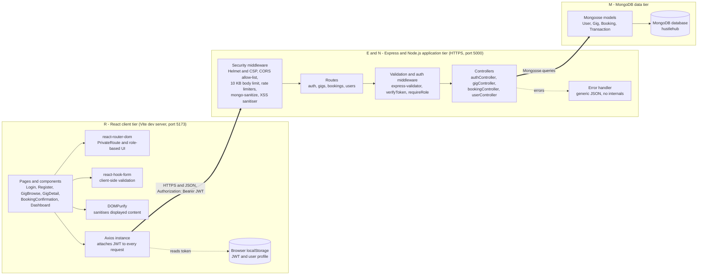
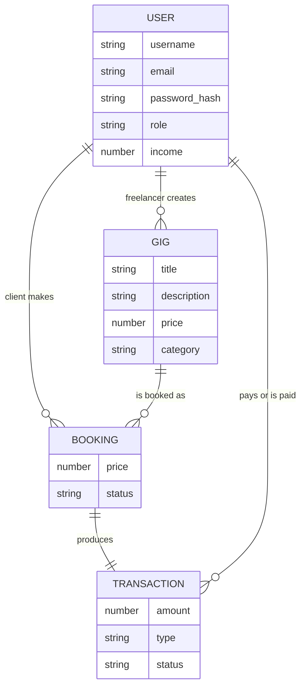
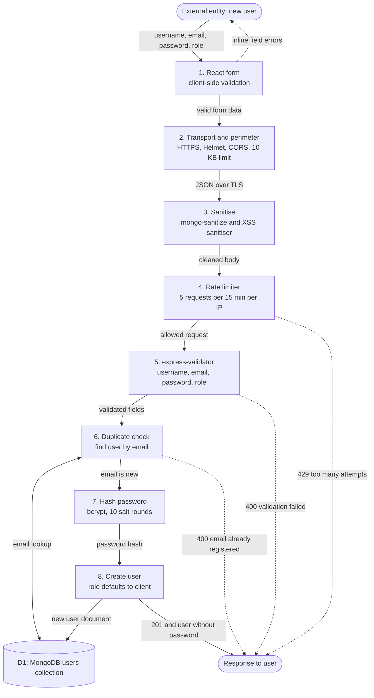
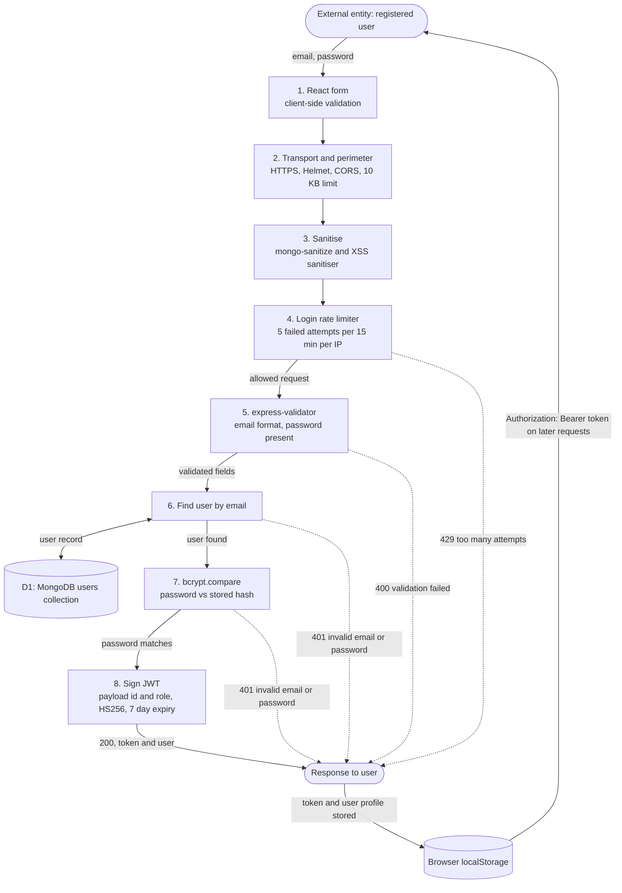
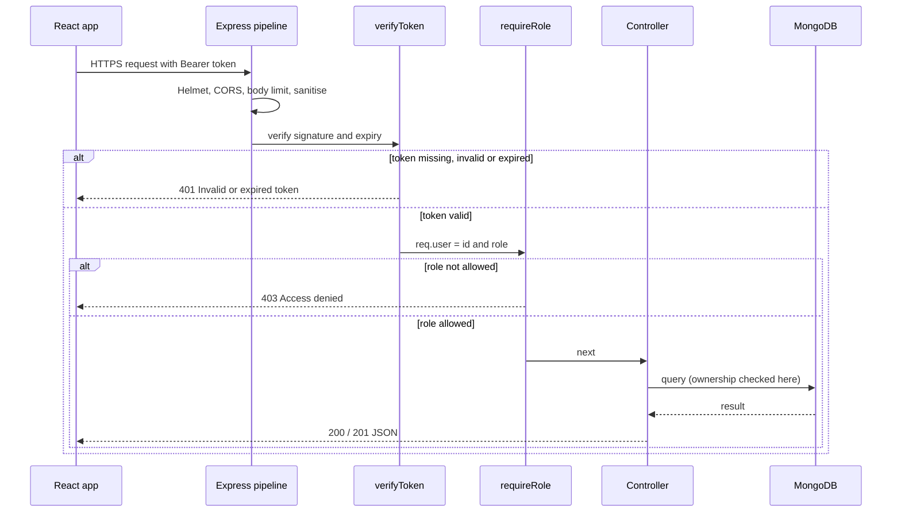
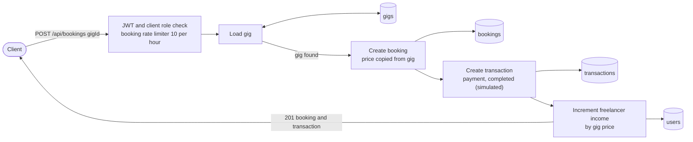
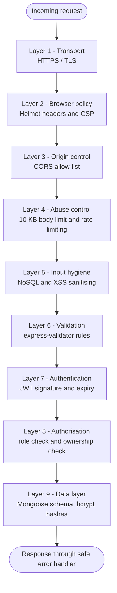

# HustleHub+ Freelance Marketplace

> **INSY7314 – POE Part 2.** A secure MERN-stack marketplace where **Clients** book services from **Freelancers**.
> Part 1 delivered the secure authentication backend. Part 2 adds MongoDB persistence, gig management, simulated bookings and transactions, freelancer income tracking, extra security middleware, a React frontend, and automated API and UI tests.

## Table of Contents

1. [System Overview](#1-system-overview)
2. [Intended Users and Roles](#2-intended-users-and-roles)
3. [System Architecture (MERN)](#3-system-architecture-mern)
4. [Data Flow: Register and Login](#4-data-flow-register-and-login)
5. [Security Design Decisions (and the alternatives we rejected)](#5-security-design-decisions-and-the-alternatives-we-rejected)
6. [Security Risks, Vulnerabilities and Mitigations](#6-security-risks-vulnerabilities-and-mitigations)
7. [Part 2 Features](#7-part-2-features)
8. [API Documentation](#8-api-documentation)
9. [Setup: Running the Application](#9-setup-running-the-application)
10. [Testing: Postman, Newman and Frontend Tests](#10-testing-postman-newman-and-frontend-tests)
11. [Demonstration Video](#11-demonstration-video)
12. [Appendix A: How the Part 1 Feedback Was Addressed](#appendix-a-how-the-part-1-feedback-was-addressed)
13. [Appendix B: Part 1 Evidence Screenshots](#appendix-b-part-1-evidence-screenshots)

---

## 1. System Overview

**The problem.** Freelancers and the people who hire them often rely on informal channels (chat apps, social media DMs) where identities cannot be verified, work is not recorded, and payments are untraceable. Platforms that do exist handle sensitive data (credentials, earnings, personal details), which makes them an attractive target for attackers.

**Our solution.** HustleHub+ is a marketplace that treats security as a first-class requirement rather than an add-on. Freelancers publish **gigs** (a service with a title, description, price and category). Clients browse gigs and **book** them. Every booking produces a **transaction** record that links the client and the freelancer, and the freelancer's **income** is tracked automatically. Payment is **simulated** (no real payment provider and no card data), which keeps the project out of payment-card compliance scope while still demonstrating the full booking workflow.

**What the system does**

| Area | What it provides | Delivered in |
|---|---|---|
| Authentication | Registration with strong validation, bcrypt-hashed passwords, JWT login | Part 1 |
| Authorisation | Role-based access control (client / freelancer / admin) plus ownership checks | Part 1 and 2 |
| Persistence | MongoDB with Mongoose models: User, Gig, Booking, Transaction | Part 2 |
| Gig management | Create, read, update, delete gigs. Only the owning freelancer may change a gig | Part 2 |
| Bookings and transactions | A client books a gig. A booking and a transaction are created together | Part 2 |
| Income tracking | A freelancer-only endpoint returns total income and the transaction list | Part 2 |
| Hardening | Rate limiting, NoSQL and XSS sanitisation, Helmet security headers, HTTPS, CORS allow-list, safe error handling | Part 1 and 2 |
| Frontend | React single-page app: register, login, browse gigs, gig detail, booking confirmation, freelancer dashboard | Part 2 |
| Quality assurance | Postman collection with Newman CLI runs, and React Testing Library component tests | Part 2 |

**Technology stack**

| Layer | Technology |
|---|---|
| Database | MongoDB with Mongoose ODM |
| Back end | Node.js and Express 4 over HTTPS |
| Front end | React 18 (Vite), react-router-dom, react-hook-form, Axios, DOMPurify |
| Security libraries | bcrypt, jsonwebtoken, helmet, cors, express-rate-limit, express-mongo-sanitize, express-validator |
| Testing | Postman and Newman (API), Vitest and React Testing Library (UI) |

---

## 2. Intended Users and Roles

HustleHub+ has three kinds of user. The role is stored on the user record and embedded in the JWT, and the server enforces it on every protected route.

| Role | Who they are | What they can do | What they cannot do |
|---|---|---|---|
| **Client** | A person or business hiring a freelancer. This is the default role at registration. | Register and log in. Browse gigs. Book a gig. View their own bookings. | Create, edit or delete gigs. View income. |
| **Freelancer** | A service provider selling gigs. | Register and log in. Create gigs. Edit and delete **only their own** gigs. View bookings made on their gigs. View income and transactions. | Book gigs. Modify another freelancer's gigs. |
| **Administrator** | A platform operator. | The `admin` role exists in the data model and the RBAC middleware. An admin sees all bookings through `GET /api/bookings/me`. | Cannot be created through the public registration form (it only accepts `client` or `freelancer`). Admin accounts must be created directly in the database. Dedicated admin tools (user moderation, gig takedown) are out of scope for this phase. |

**Permission matrix**

| Action | Public (no token) | Client | Freelancer | Admin |
|---|:---:|:---:|:---:|:---:|
| Register / log in | Yes | Yes | Yes | Yes |
| View all gigs / one gig | Yes | Yes | Yes | Yes |
| Create a gig | No (401) | No (403) | Yes | No (403) |
| Update / delete a gig | No (401) | No (403) | Own gigs only (403 otherwise) | No (403) |
| Book a gig | No (401) | Yes | No (403) | No (403) |
| View own bookings | No (401) | Yes | Yes (bookings on own gigs) | Yes (all bookings) |
| View income | No (401) | No (403) | Yes | No (403) |

---

## 3. System Architecture (MERN)

The architecture diagram below shows the **components of the system** and where each one sits in the MERN stack. It is different from a *flow diagram*: it shows *what the parts are*, whereas the data-flow diagrams in [section 4](#4-data-flow-register-and-login) show *how data moves* through them.



**Where each component falls in the stack**

| MERN layer | Component | Responsibility |
|---|---|---|
| **R** (React) | Pages and components (`client/src/pages`, `client/src/components`) | User interface and user interaction |
| **R** | `PrivateRoute`, `AuthContext` | Route protection and session state in the browser |
| **R** | `axiosInstance.js` | Single place that attaches the JWT and converts API errors into friendly messages |
| **R** | react-hook-form, DOMPurify | Client-side validation and safe rendering of user-supplied text |
| **E** (Express) | `server.js`, `routes/` | HTTP server, middleware pipeline, API endpoints |
| **E** | `middlewares/` | JWT verification, role checks, validation, XSS sanitising, error handling |
| **N** (Node.js) | `controllers/`, `config/env.js` | Business logic (booking, income update, ownership checks) and environment configuration |
| **M** (MongoDB) | `models/` and the database | Persistent storage for users, gigs, bookings and transactions |

**Project structure**

```
INSY7314Group/
├── server.js                  # HTTPS server and middleware pipeline
├── config/env.js              # Loads and validates environment variables
├── routes/                    # authRoutes, gigRoutes, bookingRoutes, userRoutes
├── controllers/               # authController, gigController, bookingController, userController
├── middlewares/               # auth.js (JWT + RBAC), validation.js, xssSanitize.js, errorHandler.js
├── models/                    # User.js, Gig.js, Booking.js, Transaction.js
├── HustleHub_Part1.postman_collection.json
├── HustleHub_Part2.postman_collection.json   # Newman test suite
├── client/                    # React frontend (Vite)
│   └── src/ { api, components, context, pages }
└── docs/evidence/             # Screenshots for submission
```

**Entity relationships**



---

## 4. Data Flow: Register and Login

The diagrams use data-flow notation: rectangles are processes, cylinders are data stores, and labelled arrows show the data that moves between them. Each diagram is followed by a stage-by-stage description.

### 4.1 Registration data flow



**Step by step**

- **Stage 1 – Browser (React).** The user fills in username, email, password and role. `react-hook-form` checks the fields and shows inline errors. Nothing is sent until the form is valid. This is a usability feature only. The server never trusts it.
- **Stage 2 – Transport and perimeter.** The request travels over **HTTPS**. Helmet adds security headers. CORS checks that the request comes from an allowed origin. `express.json({ limit: '10kb' })` rejects oversized bodies with 413.
- **Stage 3 – Sanitisation.** `express-mongo-sanitize` removes keys that begin with `$` or contain `.` (NoSQL operator injection). A custom XSS sanitiser strips HTML tags from every string in the body.
- **Stage 4 – Rate limiting.** The registration limiter allows 5 requests per IP per 15 minutes. After that the API answers `429`.
- **Stage 5 – Validation.** `express-validator` enforces: username at least 3 characters and alphanumeric, a valid email (normalised), a password of at least 8 characters with an uppercase letter, a lowercase letter and a digit, and a role of `client` or `freelancer`. Failures return `400` with a per-field error list.
- **Stage 6 – Duplicate check.** The controller looks up the email in MongoDB. If it exists, the API answers `400`.
- **Stage 7 – Password hashing.** The password is hashed with bcrypt (10 salt rounds, with a random per-user salt). The plain-text password is never stored or logged.
- **Stage 8 – Persistence and response.** The user is saved (role defaults to `client`). The response is `201` and contains the user **without** the password hash (`toJSON` removes it). The React app then logs the user in automatically.

### 4.2 Login data flow



**Step by step**

- **Stage 1 – Browser.** The user enters email and password. `react-hook-form` checks that both are present and that the email looks valid.
- **Stage 2 and 3 – Perimeter and sanitisation.** Identical to registration: HTTPS, Helmet, CORS, body-size limit, then `$` and HTML stripping.
- **Stage 4 – Rate limiting.** The login limiter counts **failed** attempts only (5 per 15 minutes per IP). This slows password-guessing attacks without locking out users who log in successfully.
- **Stage 5 – Validation.** The email must be a valid address and the password must be present.
- **Stage 6 – User lookup.** The controller finds the user by email.
- **Stage 7 – Password check.** `bcrypt.compare` checks the submitted password against the stored hash. If the email does not exist **or** the password is wrong, the API returns the **same** `401 Invalid email or password.` message, so an attacker cannot tell which accounts exist.
- **Stage 8 – Token issue.** The server signs a JWT containing only the user `id` and `role`, using HS256 and a secret from the environment, valid for 7 days. The response contains the token and the user profile (no password).
- **Stage 9 – Browser session.** React stores the token and profile in `localStorage`. The Axios interceptor adds `Authorization: Bearer <token>` to every later request.

### 4.3 Protected request flow (used by gigs, bookings and income)



### 4.4 Booking data flow



---

## 5. Security Design Decisions (and the alternatives we rejected)

For each technique this section states **what we used, why we chose it, which alternatives we considered, and the trade-offs**.

### 5.1 JWT (stateless) authentication instead of server-side sessions

| | JWT in the `Authorization` header (**our choice**) | Traditional server-side sessions |
|---|---|---|
| Where state lives | In the signed token held by the client | In the server or database. The server looks the session up on every request |
| Cost per request | Verify a signature (CPU only). No database or session-store read | One session-store lookup per request |
| Scaling | Any API instance can verify the token, so no sticky sessions or shared session store are needed | Needs a shared store (for example Redis) or sticky sessions as the API scales out |
| Fit for a React SPA on another origin | Natural. The SPA calls the API with a header, with no cookie cross-site rules | Needs cross-site cookies (`SameSite`, CORS credentials) and CSRF protection |
| Revocation | Hard. A token is valid until it expires | Easy. Delete the session |
| CSRF exposure | Not exposed, because the browser does not attach the token automatically | Exposed, because cookies are sent automatically |

**Why JWT here:** the React frontend and the Express API run on different origins and the marketplace is a stateless JSON API, so a signed token that carries `id` and `role` avoids a database round trip on every request and keeps the API horizontally scalable. **Trade-off we accept:** a stolen token cannot be revoked before it expires. We mitigate this with a fixed algorithm (HS256), a strong secret loaded from the environment (the server refuses to start without one), and an expiry. A production system would shorten the access-token lifetime and add refresh tokens and a deny-list.

### 5.2 Password hashing with bcrypt

- **Chosen:** bcrypt, 10 salt rounds. Each hash includes a random salt and the work factor is adjustable, so brute force is slow and identical passwords produce different hashes.
- **Rejected:** *plain text* (a database leak exposes every password). *MD5 / SHA-256* (designed to be fast, so GPUs test billions of guesses per second, and they have no built-in salt). *Argon2id* is a strong modern alternative, but bcrypt is mature, widely audited and well supported in Node. It is an acceptable OWASP option at a work factor of 10 or more.
- **Known limit:** bcrypt only uses the first 72 bytes of a password.

### 5.3 Server-side input validation with express-validator

- **Chosen:** declarative rule chains (`trim`, `isEmail`, `normalizeEmail`, `isLength`, `matches`, `isIn`) that run before the controller and return a uniform `400`.
- **Why not rely on client-side validation:** the browser can be bypassed with Postman or `curl`, so the server must validate independently. The client-side checks in React are only for user experience.
- **Alternatives:** Joi or Zod (equally good, but express-validator plugs directly into Express middleware and includes sanitisers), or manual `if` statements (error-prone and inconsistent).

### 5.4 NoSQL injection defence: express-mongo-sanitize plus Mongoose schemas

MongoDB queries accept operator objects such as `{ "$gt": "" }`. A login body of `{"email": {"$gt": ""}}` could match every user if it reached `findOne`. `express-mongo-sanitize` strips `$` and `.` keys from `req.body`, and Mongoose schemas cast fields to their declared types. Together they stop operator injection. The Newman suite sends this attack and confirms no token is issued. *Alternative:* switching to a SQL database with parameterised queries. We use MongoDB because it is the "M" in the required MERN stack.

### 5.5 XSS defence in depth

1. **On input (server):** a custom middleware strips HTML tags from all string values in `req.body` and `req.params` before they reach a controller. We wrote our own because the `xss-clean` package is unmaintained.
2. **On output (client):** React escapes text by default, and `DOMPurify` sanitises gig titles, descriptions and categories again before they are displayed.
3. **Browser policy:** Helmet sends a Content-Security-Policy header (see 5.7).

Stripping tags on input is not a complete defence on its own (the right defence is encoding on output), which is why the layers overlap.

### 5.6 Rate limiting with express-rate-limit

| Endpoint | Limit | Counts | Reason |
|---|---|---|---|
| `POST /api/auth/login` | 5 per 15 min per IP | Failed attempts only | Brute-force and credential-stuffing protection. Successful logins never lock out real users |
| `POST /api/auth/register` | 5 per 15 min per IP | All requests | Limits automated account creation |
| `/api/bookings` | 10 per hour per IP | All requests | Limits booking spam |

*Alternatives:* per-account lockout (lets an attacker lock out a victim on purpose), CAPTCHA (hurts usability and needs a third-party service), or a WAF or API gateway (right for production, not for this project). The limiter uses the default in-memory store, so counters reset when the server restarts. A multi-instance deployment would use a shared store such as Redis.

### 5.7 Helmet and Content Security Policy

Helmet sets a bundle of protective headers: `Content-Security-Policy`, `Strict-Transport-Security`, `X-Content-Type-Options: nosniff`, `X-Frame-Options`, and it removes `X-Powered-By`. Setting these by hand is easy to get wrong. A CSP tells the browser which sources of script and content are allowed, which limits the damage if an XSS payload ever slips through. The Newman suite checks that these headers are present.

### 5.8 Role-based access control (RBAC) and ownership checks

- **RBAC:** `requireRole('freelancer')` and `requireRole('client')` middleware return `403` for the wrong role.
- **Ownership (prevents IDOR / broken object-level authorisation):** a freelancer may only update or delete a gig whose `freelancer` field equals their own user ID, so knowing another gig's ID is not enough. This is checked in the controller on the server.
- **Why not just hide buttons in React?** UI hiding is cosmetic. The server must enforce the rules, because anyone can call the API directly. *Alternatives* such as attribute-based access control or a library like CASL are more flexible but unnecessary for three fixed roles.

### 5.9 HTTPS everywhere

The server only starts if `key.pem` and `cert.pem` exist, and it serves over TLS. This protects passwords and JWTs in transit. Development uses a self-signed certificate. Production would use a CA-issued certificate (for example Let's Encrypt) behind a reverse proxy.

### 5.10 Safe error handling

A global error handler returns a standard JSON shape and a generic message for server errors, so file paths, queries and library errors are never leaked. Login uses one message for "unknown email" and "wrong password" to prevent user enumeration. Errors are logged on the server only.

### 5.11 Secrets and configuration

`JWT_SECRET`, `MONGO_URI` and the other settings live in `.env`, which is excluded by `.gitignore`, as are the `*.pem` private keys. `config/env.js` stops the server at start-up if `JWT_SECRET` is missing, so the application can never silently run with a blank secret. A `.env.example` file documents the required variables without exposing real values.

### 5.12 Simulated payments

Bookings create a `Transaction` record but no real payment is taken, and no card data is collected or stored. This removes the highest-risk data from the system and keeps it outside payment-card (PCI-DSS) scope.

### 5.13 JWT in `localStorage` (a conscious trade-off)

The frontend stores the token in `localStorage` and attaches it with an Axios interceptor. The alternative is an `httpOnly`, `SameSite` cookie, which JavaScript cannot read (so XSS cannot steal it) but which brings CSRF risk and cross-origin cookie configuration. We chose `localStorage` for simplicity with a separate API origin, and we compensate with output sanitisation (React escaping and DOMPurify), server-side tag stripping and CSP. See [section 6.3](#63-known-limitations-and-recommended-improvements).

---

## 6. Security Risks, Vulnerabilities and Mitigations

### 6.1 Defence in depth: the layers a request passes through



### 6.2 Threat model: risk, how it is exploited, and our mitigation

| # | Threat (OWASP category) | How it could be exploited | Mitigation in HustleHub+ | Where it is verified |
|---|---|---|---|---|
| 1 | **Broken access control** (A01) | A client calls `POST /api/gigs`, a freelancer edits someone else's gig, or a client reads income | `requireRole` middleware on routes, plus ownership check in `updateGig` and `deleteGig` | Newman folders 1 and 3 (401 and 403 cases) |
| 2 | **Cryptographic failures** (A02) | Database leak exposes passwords. Traffic sniffed on the network | bcrypt hashes with salt, password never returned (`toJSON`), HTTPS only, secrets in `.env` | Newman login tests assert no password in responses |
| 3 | **Injection: NoSQL** (A03) | `{"email": {"$gt": ""}}` logs in without a valid password | `express-mongo-sanitize`, Mongoose type casting, `express-validator` | Newman folder 4: NoSQL injection request |
| 4 | **Injection: XSS** (A03) | Gig title containing `<script>` runs in other users' browsers | Server tag stripping, React escaping, DOMPurify, CSP | Newman folder 4: XSS request. Frontend test: GigCard strips script tags |
| 5 | **Insecure design: abuse** (A04) | Spam bookings or account creation | Rate limiters on login, register and bookings. Simulated payments hold no money | Newman folder 5 (429) |
| 6 | **Security misconfiguration** (A05) | Missing headers, verbose errors, open CORS | Helmet, CORS allow-list, generic error handler, fail-fast config | Newman setup folder checks headers. Folder 4 checks the malformed-ID response |
| 7 | **Identification and authentication failures** (A07) | Brute-force or credential stuffing. Forged or tampered token | Login rate limit, strong password rules, same message for unknown email and wrong password, signed JWT with expiry | Newman folder 4: tampered token and `alg=none` token return 401 |
| 8 | **Denial of service** | Huge request bodies, request floods | 10 KB body limit (413), rate limiting | Newman folder 4: 12 KB payload returns 413 |
| 9 | **Vulnerable components** (A06) | Outdated dependencies | `package-lock.json` pins versions. Run `npm audit` before release | Manual `npm audit` |
| 10 | **Logging failures** (A09) | Attacks go unnoticed | Failed logins and registrations are logged server-side without passwords | Server console output |

### 6.3 Known limitations and recommended improvements

We list these openly because a security review should name residual risk.

| Limitation | Risk | Recommended improvement |
|---|---|---|
| JWT lasts 7 days and cannot be revoked | A stolen token stays valid | 15-minute access tokens plus refresh tokens and a deny-list |
| JWT stored in `localStorage` | Readable by any script that runs on the page (XSS) | `httpOnly`, `SameSite` cookie plus a CSRF token |
| Helmet's **default** CSP is used | The API only returns JSON so the default is restrictive, but the React app is served by Vite and has no tuned policy of its own | Define a custom `contentSecurityPolicy` for the host that serves the SPA |
| Rate-limit counters are in memory | Reset on restart and not shared across instances. Users behind one NAT share an IP | Redis-backed store |
| `updateGig` passes `req.body` straight to Mongoose | A freelancer could include fields such as `freelancer` in the body (mass assignment) | Whitelist `title`, `description`, `price`, `category` |
| Gig and booking routes have no express-validator rules | Bad input (negative price, malformed ID) reaches Mongoose and returns a generic `500` rather than a precise `400` | Add validation chains and a `CastError` to `400` mapping |
| Stack traces are returned when `NODE_ENV=development` | Information disclosure if deployed with the wrong setting | Always run with `NODE_ENV=production` outside local development |
| Booking and income update are separate writes | A failure between them could leave data inconsistent | Wrap in a MongoDB transaction |
| Registration reveals that an email is taken | Account enumeration | Generic response plus email verification |
| Self-signed development certificate | Browser warning | CA-issued certificate in production |
| The dashboard *Edit* button links to `/gigs/:id/edit`, which is not routed yet | The user sees the "Page not found" screen | Add an edit-gig page and route (the `PUT /api/gigs/:id` endpoint already exists) |

---

## 7. Part 2 Features

- **Gig management.** Freelancers create gigs (title, description, price, category). Anyone can browse gigs. Only the owner can edit or delete a gig.
- **Bookings.** A client books a gig. The price is copied from the gig at the time of booking. Payment is simulated.
- **Transactions.** Every booking automatically creates a transaction that links the client, the freelancer and the booking.
- **Income tracking.** The freelancer's `income` field is increased by the gig price on every booking. `GET /api/users/me/income` returns the total and the transaction list.
- **React frontend.** Register, login, gig browse, gig detail with a *Book Now* button (clients only), booking confirmation, My Bookings (clients) and a freelancer dashboard (own gigs, bookings and income).
- **Security additions.** MongoDB sanitisation, XSS sanitisation, rate limiting on login, register and booking, Helmet and CSP, RBAC with ownership checks. Security measures are explained in [section 5](#5-security-design-decisions-and-the-alternatives-we-rejected).

---

## 8. API Documentation

Base URL: `https://localhost:5000/api`. Protected routes need the header `Authorization: Bearer <token>`.

### 8.1 Response shapes

```jsonc
// Success (shape varies by endpoint, always contains status and usually message)
{ "status": 201, "message": "Gig created successfully!", "gig": { ... } }

// Error
{ "status": 403, "message": "Access denied. Required role: freelancer." }

// Validation error
{ "status": 400, "message": "Validation failed",
  "errors": [ { "field": "password", "message": "Password must contain at least one number." } ] }
```

### 8.2 Authentication

| Method and path | Auth | Body | Success | Errors |
|---|---|---|---|---|
| `POST /api/auth/register` | None | `username` (3+ letters or numbers), `email`, `password` (8+ chars, upper, lower, digit), `role` (`client` or `freelancer`, optional) | `201` with `user` (no password) | `400` validation or duplicate email, `429` rate limited |
| `POST /api/auth/login` | None | `email`, `password` | `200` with `token` and `user` | `400` validation, `401` invalid email or password, `429` too many failed attempts |
| `GET /api/auth/me` | Any logged-in user | none | `200` with `user` | `401` |

Example login response:

```json
{ "status": 200, "message": "Login successful.", "token": "eyJhbGciOi...", "user": { "_id": "...", "username": "someone", "email": "someone@gmail.com", "role": "client", "income": 0 } }
```

### 8.3 Gigs

| Method and path | Auth | Description | Success | Errors |
|---|---|---|---|---|
| `GET /api/gigs` | Public | All gigs (with freelancer name) | `200` `{ count, gigs }` | |
| `GET /api/gigs/:id` | Public | One gig | `200` `{ gig }` | `404` |
| `POST /api/gigs` | Freelancer | Body: `title`, `description`, `price`, `category` | `201` `{ gig }` | `401`, `403` |
| `PUT /api/gigs/:id` | Freelancer (owner) | Update own gig | `200` `{ gig }` | `401`, `403` (not owner or not freelancer), `404` |
| `DELETE /api/gigs/:id` | Freelancer (owner) | Delete own gig | `200` | `401`, `403`, `404` |

### 8.4 Bookings and transactions

| Method and path | Auth | Description | Success | Errors |
|---|---|---|---|---|
| `POST /api/bookings` | Client | Body: `gigId`. Creates a booking and a transaction and increases the freelancer's income | `201` `{ booking, transaction }` | `401`, `403`, `404` gig not found, `429` |
| `GET /api/bookings/me` | Any logged-in user | Client: own bookings. Freelancer: bookings on own gigs. Admin: all | `200` `{ count, bookings }` | `401` |

### 8.5 Income

| Method and path | Auth | Description | Success | Errors |
|---|---|---|---|---|
| `GET /api/users/me/income` | Freelancer | Total income and transactions | `200` `{ totalIncome, transactionCount, transactions }` | `401`, `403` for clients |

### 8.6 Other

`GET /api/health` returns `200` and confirms the API is running.

---

## 9. Setup: Running the Application

### 9.1 Prerequisites

| Tool | Version | Used for |
|---|---|---|
| Node.js and npm | Node 18 LTS or newer (20 recommended) | Backend and frontend |
| MongoDB | A MongoDB Atlas cluster (the team uses a free shared cluster), **or** MongoDB Community Server 6+ running locally | Database |
| OpenSSL | Any recent version (included with Git Bash on Windows) | Generating the HTTPS certificate |
| Git | Any | Cloning the repository |
| Postman | Optional | Manual API testing |
| Newman | `npm install -g newman` | Running the Postman collection from the command line |

### 9.2 Dependencies

All dependencies are installed automatically by `npm install`.

**Backend (`package.json`)**

| Package | Purpose |
|---|---|
| express | Web framework |
| mongoose | MongoDB object modelling and schema validation |
| bcrypt | Password hashing |
| jsonwebtoken | Create and verify JWTs |
| express-validator | Server-side input validation |
| helmet | Security headers and CSP |
| cors | CORS allow-list |
| express-rate-limit | Rate limiting |
| express-mongo-sanitize | NoSQL injection protection |
| dotenv | Loads `.env` |
| nodemon (dev) | Restarts the server on change (`npm run dev`) |

**Frontend (`client/package.json`)**

| Package | Purpose |
|---|---|
| react, react-dom | UI library |
| react-router-dom | Routing and protected routes |
| react-hook-form | Form handling and client-side validation |
| axios | HTTP client with JWT interceptor |
| dompurify | Sanitises displayed user content |
| vite, @vitejs/plugin-react | Dev server and build tool |
| vitest, jsdom | Test runner and browser-like environment |
| @testing-library/react, @testing-library/jest-dom, @testing-library/user-event | Component testing |

### 9.3 Step-by-step: backend

1. **Clone the repository**
   ```bash
   git clone https://github.com/ChippsEthan/INSY7314Group.git
   cd INSY7314Group
   ```
2. **Install backend dependencies**
   ```bash
   npm install
   ```
3. **Create the environment file.** Copy `.env.example` to `.env`:
   ```bash
   cp .env.example .env        # Windows PowerShell: copy .env.example .env
   ```
   Then edit `.env`:
   ```env
   PORT=5000
   NODE_ENV=development
   JWT_SECRET=replace_with_a_long_random_string_of_at_least_32_characters
   SALT_ROUNDS=10
   MONGO_URI=mongodb://localhost:27017/hustlehub
   ```
   *Generate a strong secret with:* `node -e "console.log(require('crypto').randomBytes(48).toString('hex'))"`.
   *Using the team's Atlas cluster?* Ask the project owner for the connection string **privately** (never commit it or paste it into the README) and put it in `MONGO_URI` as one line with no quotes. The string must include the database name before the `?`, for example `...mongodb.net/hustlehub?appName=Cluster0`. The owner must also allow your IP address in Atlas under **Network Access**, otherwise the server cannot connect.
4. **Generate the HTTPS certificate** in the project root (creates `key.pem` and `cert.pem`, which are git-ignored). Press Enter through every question:
   ```bash
   openssl req -x509 -newkey rsa:4096 -keyout key.pem -out cert.pem -days 365 -nodes
   ```
   *If `openssl` is not recognised (common on Windows PowerShell),* use Node instead. These two commands create the same kind of certificate and Chrome accepts it:
   ```bash
   npm install --no-save selfsigned@2.4.1
   ```
   ```bash
   node -e "const s=require('selfsigned').generate([{name:'commonName',value:'localhost'}],{days:365,keySize:2048,algorithm:'sha256',extensions:[{name:'subjectAltName',altNames:[{type:2,value:'localhost'},{type:7,ip:'127.0.0.1'}]}]});require('fs').writeFileSync('key.pem',s.private);require('fs').writeFileSync('cert.pem',s.cert);console.log('done')"
   ```
5. **Make sure MongoDB is running** (for example start the *MongoDB* service, or run `mongod`).
6. **Start the API**
   ```bash
   npm start
   ```
   You should see `MongoDB connected successfully` and `HustleHub+ API running on https://localhost:5000`.
7. **Trust the certificate in your browser (one time).** Open <https://localhost:5000/api/health> in the browser, choose *Advanced*, then *Proceed*. You should see `HustleHub+ API is running.` Without this step the React app's requests will be blocked by the browser.

### 9.4 Step-by-step: React frontend

1. Open a **second terminal** and go to the client folder:
   ```bash
   cd client
   npm install
   ```
2. Create `client/.env` from the example:
   ```bash
   cp .env.example .env
   ```
   ```env
   VITE_API_URL=https://localhost:5000
   ```
3. Start the dev server:
   ```bash
   npm run dev
   ```
4. Open <http://localhost:5173>.

### 9.5 Using the app

1. Register one **freelancer** and one **client** (use two browsers or one normal and one private window).
2. As the freelancer choose *Post a Gig* and create a gig.
3. As the client open *Browse Gigs*, open the gig and choose *Book Now*. You will see the booking confirmation.
4. As the freelancer open *Dashboard* to see the new booking and the updated income.

**Screenshots of the running application**

*Register*


*Login*


*Freelancer posts a gig*


*Browse gigs*


*Gig details with the Book Now button (clients only)*


*Booking confirmation*


*Client's My Bookings page*


*Freelancer dashboard with bookings and income*


### 9.6 Troubleshooting

| Problem | Fix |
|---|---|
| `FATAL: JWT_SECRET is not defined` | Create `.env` (step 3) |
| `key.pem or cert.pem not found` | Run the OpenSSL command in step 4 from the project root |
| `Failed to start: ... ECONNREFUSED` | MongoDB is not running, or `MONGO_URI` is wrong |
| Browser shows *Network Error* on the React app | Open <https://localhost:5000/api/health> and accept the certificate (step 7) |
| Postman cannot connect | Turn off *SSL certificate verification* in Postman settings |
| `429 Too many attempts` while testing | The in-memory limiter is full. Restart the server |
| `Could not connect to any servers in your MongoDB Atlas cluster` | Your IP is not on the Atlas **Network Access** list. Ask the cluster owner to add it |
| `Invalid scheme, expected connection string to start with mongodb://` | The `MONGO_URI` line in `.env` is broken: check for a line break, extra spaces or quotation marks |
| Chrome shows `ERR_CERT_INVALID` with no *Proceed* link | Click the error page and type `thisisunsafe`. If that fails, regenerate the certificate with the Node commands in step 4 |
| `bcrypt` fails to load after `npm install` | Run `npm approve-scripts bcrypt` then `npm rebuild bcrypt` |

---

## 10. Testing: Postman, Newman and Frontend Tests

### 10.1 Postman collection

`HustleHub_Part2.postman_collection.json` (in the repository root) contains **47 requests and 88 test assertions** organised into six folders. The collection creates its own fresh users each run (unique emails using a run ID), so it needs no manual setup.

| Folder | What it proves |
|---|---|
| 0. Setup | Health check. Security headers present (CSP, nosniff, HSTS, no `X-Powered-By`). Creates a freelancer A, a freelancer B and a client, and logs them in |
| 1. Gig CRUD | Create, read, update, delete succeed for the owner. No token gives 401. A client gets 403. **Freelancer B cannot edit or delete freelancer A's gig (403).** Deleted gig returns 404 |
| 2. Bookings | Client booking succeeds and creates a linked transaction. Missing `gigId`, unknown gig, freelancer attempting to book (403), no token (401). Both client and freelancer can list bookings |
| 3. Income | Freelancer sees total income equal to the booked price. Client gets **403**. No token gets 401 |
| 4. Invalid and malicious input | XSS payload is stripped. 12 KB payload gets 413. NoSQL injection gets no token. Tampered and `alg=none` JWTs get 401. Malformed ID does not leak internals |
| 5. Rate limiting | Seven rapid failed logins. The seventh returns **429** |

### 10.2 Running with Newman

1. Install Newman once: `npm install -g newman`
2. Make sure MongoDB is running, then **start a fresh server** (stop it with Ctrl+C and run `npm start` again). This matters because the rate limiters are held in memory, and the last folder deliberately fills the login limiter.
3. In a second terminal, from the project root run:
   ```bash
   npm run test:api
   ```
   which is the same as:
   ```bash
   newman run HustleHub_Part2.postman_collection.json --insecure
   ```
   (`--insecure` is needed because the development certificate is self-signed.)
4. The run ends with a summary table. Our result is shown below: **47 requests, 88 assertions, 0 failed.**
5. *Optional:* export a JSON report with
   `newman run HustleHub_Part2.postman_collection.json --insecure -r cli,json --reporter-json-export docs/evidence/newman-report.json`

**Tip:** to keep test users and gigs out of the team's real data, point your own `.env` at a separate database on the same cluster by changing only the database name, for example `...mongodb.net/hustlehub_test?appName=Cluster0`. MongoDB creates it automatically.

**Re-running:** restart the server before every run (the previous run used up the rate-limit allowances).

**Newman results (88 of 88 assertions passing):**


### 10.3 Frontend automated tests

The frontend uses **React Testing Library** with **Vitest**. Vitest is the test runner built for Vite projects and has the same `describe` / `it` / `expect` API as Jest, so Jest-style tests run unchanged, with `jest.fn()` written as `vi.fn()`.

Run from the `client` folder:

```bash
cd client
npm test
```

| Test file | What it covers |
|---|---|
| `src/pages/components.test.jsx` | **LoginPage:** renders email and password fields, and shows "Email is required" and "Password is required" when submitted empty. **GigCard:** renders title, price and category from props. **Navbar:** shows Login and Register when logged out, shows username and Logout when logged in, and shows freelancer-only links. **BookingConfirmationPage:** shows the "Booking Confirmed!" message and the gig title and price |
| `src/components/rbac.test.jsx` | **PrivateRoute:** redirects to `/login` when logged out, redirects a client away from a freelancer-only route, and renders the page for the right role. **Navbar:** a client does not see freelancer links. **GigCard:** a `<script>` tag in a gig title is removed (XSS) |

Result: **2 test files, 15 tests, all passing** (`components.test.jsx` has 10 tests and `rbac.test.jsx` has 5). The yellow React Router "Future Flag Warning" lines in the output are harmless notices about the upcoming React Router v7.


### 10.4 Where to find the evidence

| Evidence | Location |
|---|---|
| Postman collection | `HustleHub_Part2.postman_collection.json` |
| Newman terminal output | `docs/evidence/newman-run-1.png`, `newman-run-2.png`, `newman-run-3.png` |
| Frontend test output | `docs/evidence/frontend-tests.png` |
| Application screenshots | `docs/evidence/screenshots/` (shown in section 9.5) |
| Part 1 Postman screenshots | [Appendix B](#appendix-b-part-1-evidence-screenshots) |

---

## 11. Demonstration Video

YouTube link: **ADD LINK HERE BEFORE SUBMISSION**

---

## Appendix A: How the Part 1 Feedback Was Addressed

| Feedback from Part 1 | Where it is addressed |
|---|---|
| System overview too basic | [Section 1](#1-system-overview): problem statement, feature table, technology stack |
| System architecture is different from a flow diagram | [Section 3](#3-system-architecture-mern) shows the architecture (components). [Section 4](#4-data-flow-register-and-login) shows the data flow |
| Architecture diagram must show MERN components and where each falls in the stack | [Section 3](#3-system-architecture-mern): diagram plus a table mapping each component to R, E, N or M |
| Data flow diagram and detailed description for Register and Login | [Sections 4.1 and 4.2](#41-registration-data-flow): diagrams and stage-by-stage bullet points. Sections 4.3 and 4.4 add the protected-request and booking flows |
| Step-by-step instructions to run and install dependencies | [Section 9](#9-setup-running-the-application): prerequisites, dependency tables, backend and frontend steps, troubleshooting |
| Why each decision was made, including alternatives (for example JWT vs sessions) | [Section 5](#5-security-design-decisions-and-the-alternatives-we-rejected): chosen option, rejected alternatives and trade-offs for every technique |
| Comprehensive security risks, vulnerabilities and mitigations with diagrams | [Section 6](#6-security-risks-vulnerabilities-and-mitigations): layered-defence diagram, OWASP threat table, known limitations |
| Intended users (Clients, Freelancers, Administrators) and their roles | [Section 2](#2-intended-users-and-roles): role descriptions and a permission matrix |

---

## Appendix B: Part 1 Evidence Screenshots

These screenshots were captured during Part 1 and are kept as evidence of the original authentication backend.

### B.1 Part 1 security implementation (code)

#### Password Hashing
Passwords are never stored in plain text. They are hashed with bcrypt (10 salt rounds).


#### JWT Authentication 
When you login successfully a JWT token will be generated containing the users ID and their role , this JWT token is then sent to the Authorization header for protected routes.


#### Input validation
express-validator checks all incoming data and make sure it is valid before we process the data, this keeps us safe from injection attacks and ensures our data's integrity.


#### Secure Error Handling
we have a global error handler that will catch all exceptions this will return a standardised JSON response without giving away our file paths , configuration values or our stack traces.


### B.2 Part 1 Postman results

###### Part 1 Postman tests

##### Server Health


##### Registration

######## Success


######## Duplicate


######## Missing a password


##### Logging in

######## Success


######## Failed login (wrong password)


##### Protected Route 

######## With a token


######## Without a token

